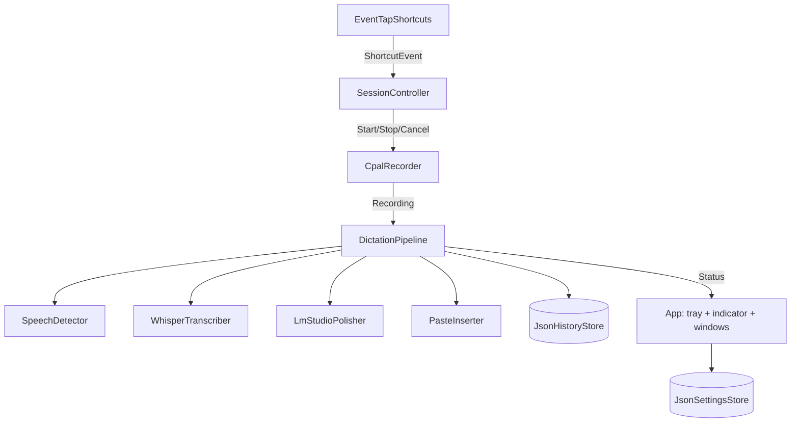

# Voice Dictation for Mac — Architecture Design

**Status:** Confirmed
**Source PRD:** `.sdd/2026-11-22-voice-dictation/PRD.md`
**Tech context:** Rust 2021 (stable) · Cargo workspace · egui/eframe UI · whisper.cpp (via `whisper-rs`, Metal) for on-device speech · LM Studio OpenAI-compatible `/v1/chat/completions` for polishing · macOS 13+, Apple silicon

---

## 1. Design Goal & Guiding Principle

- **In one sentence:** turn a shortcut-driven recording into polished text inserted at the cursor, with every external capability (microphone, speech model, writing assistant, keyboard/clipboard, disk) behind a port so the dictation rules are pure, testable Rust.
- **Guiding principle:** *Hexagonal core.* `voice-core` owns all business rules (session state machine, thresholds, fallback chain, dictionary/history invariants) and defines traits (ports). Every other crate is an adapter implementing one port. Swapping the speech engine, the writing assistant, or the insertion method is add-only: implement the trait, wire it in `app`.

---

## 2. Change Scope

Greenfield repository — everything is **Add**.

| Area | Action | What / Why |
| :--- | :--- | :--- |
| `crates/voice-core` | **Add** | Domain types, ports (traits), `SessionController` state machine, `DictationPipeline` fallback chain, `PersonalDictionary`, `History`, `Settings`. No I/O, no platform deps. |
| `crates/voice-audio` | **Add** | `Recorder` port via `cpal`; resampling to 16 kHz mono; live level. |
| `crates/voice-stt` | **Add** | `Transcriber` port via `whisper-rs` (Metal); model-file location + optional download of default model. |
| `crates/voice-polish` | **Add** | `Polisher` port: LM Studio chat-completions client (`ureq`, 20 s timeout) + prompt builder. |
| `crates/voice-storage` | **Add** | `SettingsStore` / `HistoryStore` ports: JSON files in `~/Library/Application Support/VoiceAssistant/`. |
| `crates/voice-macos` | **Add** | `ShortcutSource` (global key listener via CGEventTap), `TextInserter` (clipboard + ⌘V + restore), `PermissionProbe` (mic / accessibility). |
| `app` (binary `voice-assistant`) | **Add** | eframe app: tray icon menu, floating indicator viewport, Settings and History windows, wiring of all adapters into the core. |
| Cloud services, accounts, translation, speak-to-edit | **Not touched** | Out of scope per PRD. |

---

## 3. New Classes / Modules

| Name | Kind | Responsibility (purpose) | Collaborators | Satisfies (PRD scenario) |
| :--- | :--- | :--- | :--- | :--- |
| `SessionController` | State machine (core) | Turn shortcut/clock events into session commands; enforce one-at-a-time, 0.5 s min (inclusive), 5 min max, Escape cancel | `Clock` (injected `Instant`s) | US-01, US-02 all |
| `DictationPipeline` | Service (core) | `process(recording) -> Outcome`: speech check → transcribe → polish (or skip) → insert → record history; owns the whole fallback chain | `Transcriber`, `Polisher`, `TextInserter`, `HistoryStore`, `SpeechDetector` | US-03 cleanup-off, US-05 all, US-07 not-recorded |
| `SpeechDetector` | Policy (core) | Decide if a recording contains speech (RMS energy over frames) — prevents whisper hallucinating on silence | — | US-05 silence |
| `PersonalDictionary` | Value object (core) | Trimmed, non-blank, de-duplicated (case-sensitive, insertion-ordered) word list | — | US-04 duplicates / blanks |
| `History` | Aggregate (core) | Newest-first list capped at 200 | — | US-07 all |
| `Settings` | Value object (core, serde) | Shortcuts, mic name, assistant base URL + model, cleanup on/off, dictionary, speech model path; `Default` = PRD defaults | — | US-08 |
| `Status` | Enum (core) | `Idle, Listening{level}, Working, Done, Cancelled, Problem(Problem)` with user-facing text | — | All status `Then`s |
| `Problem` | Enum (core) | `NoSpeech, AssistantUnreachable, MicrophonePermission, AccessibilityPermission, Other(String)` + message text | — | US-05 |
| `CpalRecorder` | Adapter | `Recorder`: start/stop/cancel capture from named or default device; fallback to default if missing | `cpal`, `rubato` or linear resample | US-01, US-05 mic |
| `WhisperTranscriber` | Adapter | `Transcriber`: load model once, transcribe 16 kHz mono with language auto-detect; dictionary words given as initial prompt | `whisper-rs` | US-03, US-04 |
| `LmStudioPolisher` | Adapter | `Polisher`: build system prompt (rules + dictionary), send transcript delimited as data, 20 s timeout, return text or `PolishError` | `ureq`, `serde_json` | US-03, US-04, US-05 |
| `PromptBuilder` | Pure fn (polish) | Construct system/user messages; dictated content wrapped in `<transcript>` tags and declared non-instruction | — | US-03 question/command |
| `JsonSettingsStore` / `JsonHistoryStore` | Adapter | Load/save atomically (write tmp + rename); missing file → defaults/empty | `directories`, `serde_json` | US-07, US-08 |
| `EventTapShortcuts` | Adapter | Global listener for right-Option hold, ⌃⌥Space, Escape → `ShortcutEvent`s on a channel | `core-graphics` event tap | US-01, US-02 |
| `PasteInserter` | Adapter | Save clipboard → set text → post ⌘V → wait → restore (or clear if was empty); if not AX-trusted, leave text on clipboard and return `AccessibilityPermission` | `arboard`, `core-graphics` | US-05 accessibility, US-06 all |
| `MacPermissions` | Adapter | `microphone_granted()`, `accessibility_granted()` (AXIsProcessTrusted) | `objc2`/FFI | US-05 permission scenarios |
| `App` (eframe) | UI | Tray menu, indicator viewport (always-on-top, no focus, mouse-passthrough), Settings and History windows; runs controller on a worker thread, receives `Status` over a channel | all above | US-07 UI, US-08 UI, status display |

### Ports (defined in `voice-core::ports`)

```rust
pub trait Recorder: Send { fn start(&mut self) -> Result<(), Problem>; fn stop(&mut self) -> Recording; fn cancel(&mut self); fn level(&self) -> f32; }
pub trait Transcriber: Send + Sync { fn transcribe(&self, rec: &Recording, dictionary: &PersonalDictionary) -> Result<String, String>; }
pub trait Polisher: Send + Sync { fn polish(&self, raw: &str, dictionary: &PersonalDictionary) -> Result<String, PolishError>; }
pub trait TextInserter: Send + Sync { fn insert(&self, text: &str) -> Result<(), Problem>; }
pub trait HistoryStore: Send + Sync { fn load(&self) -> History; fn save(&self, h: &History) -> Result<(), String>; }
pub trait SettingsStore: Send + Sync { fn load(&self) -> Settings; fn save(&self, s: &Settings) -> Result<(), String>; }
```

> One business action = one call: the UI calls `SessionController::handle(event, now)`; the worker calls `DictationPipeline::process(recording)`. Callers never sequence transcribe/polish/insert themselves.

---

## 4. Modified Components

None (greenfield).

---

## 5. Component Relationships



Threading: event tap on its own CFRunLoop thread → `crossbeam-channel` → **engine thread** (owns controller + recorder, runs pipeline) → `Status` channel → UI thread (`ctx.request_repaint()`). The 5-minute limit is enforced by the engine thread ticking the controller every 100 ms.

---

## 6. Extensibility & Handoff Notes

- **Most likely next requirement:** a different speech engine (Apple Speech, cloud) or a different writing assistant (Ollama, OpenAI), and per-app writing styles.
- **Where it lands:** `Transcriber` / `Polisher` traits; prompt construction in `PromptBuilder` accepts a style parameter later.
- **How to add it:** add a crate implementing the trait; select it in `app::wiring` from `Settings`. No core change.
- **Patterns applied & why:** Ports & Adapters (isolate every platform/IO axis); State machine for the session (timing rules are the most bug-prone, so they are pure and tested with synthetic `Instant`s); Strategy via traits for engines.
- **Do not hardcode:** shortcuts, assistant URL/model, mic, model path (all in `Settings`); thresholds live as named constants in `voice-core::rules`.
- **Known debt / deferred:** no streaming transcription; clipboard restore only handles text (non-text clipboard content is not restored) — revisit if users report loss of images.

---

## 7. Traceability

| PRD Scenario | Fulfilled by |
| :--- | :--- |
| US-01 Holding the shortcut dictates into the front app | `EventTapShortcuts` → `SessionController` → `DictationPipeline` → `PasteInserter` |
| US-01 A press of exactly half a second counts | `SessionController` (`MIN_DURATION` inclusive) |
| US-01 A very short press is ignored | `SessionController` → `Command::Discard`, status Idle |
| US-01 Escape cancels push-to-talk | `SessionController` → `Recorder::cancel`, `Status::Cancelled` |
| US-02 Toggle starts and stops | `SessionController` (hands-free mode) |
| US-02 Stops at 5-minute limit | `SessionController::handle(Tick)` + engine 100 ms tick |
| US-02 Escape cancels hands-free | `SessionController` |
| US-03 Fillers / self-corrections / mixed language / lists | `LmStudioPolisher` + `PromptBuilder` rules |
| US-03 Question written, not answered; command not obeyed | `PromptBuilder` (transcript as tagged data) |
| US-03 Cleanup off writes raw | `DictationPipeline` (`settings.cleanup_enabled`) |
| US-04 Dictionary spelling used | `PromptBuilder` + `WhisperTranscriber` initial prompt |
| US-04 Empty dictionary | `PromptBuilder` omits dictionary section |
| US-04 Duplicates kept once / blanks ignored | `PersonalDictionary` |
| US-05 Assistant unreachable / too slow | `LmStudioPolisher` (20 s timeout) → `DictationPipeline` fallback + `Problem::AssistantUnreachable` |
| US-05 Silence writes nothing | `SpeechDetector` + empty-transcript check in `DictationPipeline` |
| US-05 Microphone permission missing | `MacPermissions` / `CpalRecorder::start` → `Problem::MicrophonePermission` |
| US-05 Accessibility permission missing | `PasteInserter` → `Problem::AccessibilityPermission`, text left on clipboard, history still recorded |
| US-06 Clipboard restored / empty stays empty | `PasteInserter` |
| US-07 History newest first / capped at 200 / not recording cancelled+silent | `History` + `DictationPipeline` |
| US-07 Copy entry | `App` History window → clipboard |
| US-08 Settings remembered | `JsonSettingsStore` |
| US-08 First-launch defaults | `Settings::default()` |

---

## 8. Risks & Open Decisions

- **Risks / trade-offs:** CGEventTap requires Input Monitoring/Accessibility permission; unsigned dev builds must be re-granted after rebuild. whisper-rs build needs cmake + Xcode CLT (present). Clipboard-paste is the most compatible insertion method but racy — mitigated by a 150 ms delay before restore.
- **Default speech model:** `ggml-small.bin` (multilingual, good zh/en mix) at `~/Library/Application Support/VoiceAssistant/models/`; Settings offers a "Download default model" button (Hugging Face `ggerganov/whisper.cpp`).
- **Open decisions (for implementation):** exact energy threshold for `SpeechDetector` (start at RMS 0.01 over 30 ms frames, ≥ 0.25 s voiced).
