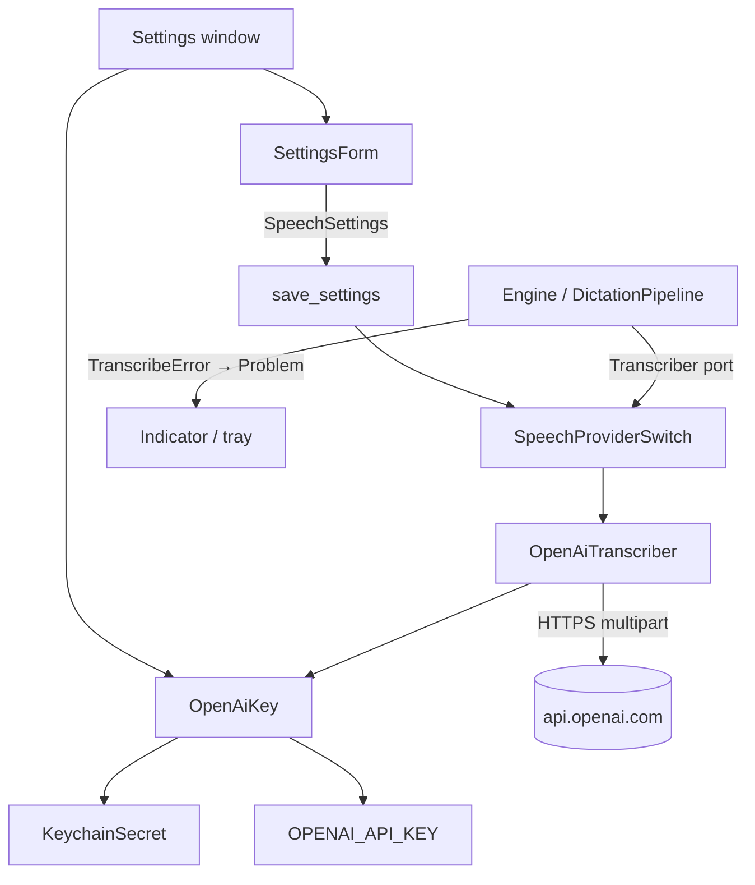

# OpenAI Speech Provider — Architecture Design

**Status:** Confirmed
**Source PRD:** `.sdd/2026-11-23-openai-speech-provider/PRD.md`
**Builds on:** `.sdd/2026-11-22-voice-dictation/ARCH.md`, `.sdd/2026-11-22-three-dictation-modes/ARCH.md` (hexagonal core, one adapter crate per port)
**Tech context:** Rust 2021 (MSRV 1.80) · Cargo workspace · egui/eframe · `ureq` 3 · `security-framework` 2 (macOS Keychain) · OpenAI `POST /v1/audio/transcriptions`

---

## 1. Design Goal & Guiding Principle

- **In one sentence:** every recording is transcribed by `OpenAiTranscriber` (multipart POST to `https://api.openai.com/v1/audio/transcriptions` with the model from `Settings::speech`), authenticated with a key resolved per call by `OpenAiKey` (Keychain first, then `OPENAI_API_KEY`), and every failure surfaces as a typed `TranscribeError` that the core pipeline turns into a provider-named `Problem`.
- **Guiding principle:** the *speech provider* is a closed enum in the core (`SpeechProvider`) that owns what the user may choose (label, offered models, default model). Adapters only know *how* to talk to one provider. Adding a provider later = one enum variant + one adapter + one arm in the app's transcriber factory; no UI or pipeline rewrite.

---

## 2. Change Scope

| Area | Action | What / Why |
| :--- | :--- | :--- |
| `voice-core` settings | **Modify (public API)** | Remove `SpeechSource` and `Settings::speech_model_path`/`speech_source`; add `SpeechProvider`, `SpeechSettings`, `Settings::speech`. Old JSON keeps loading because `Settings` is `#[serde(default)]` without `deny_unknown_fields`: the old keys are ignored and `speech` takes its default (OpenAI, `gpt-4o-transcribe`). |
| `voice-core` ports | **Modify (public API)** | `TranscribeError` gains `KeyMissing`, `KeyRejected`, `LimitReached`; `Unreachable`/`Failed` keep their meaning. `Transcriber` trait signature unchanged. |
| `voice-core` status/pipeline | **Modify (public API)** | `Problem::SpeechModelUnreachable` replaced by provider-tagged speech problems (below); pipeline maps every `TranscribeError` to one of them (`Failed` no longer leaks its raw reason to the user — it is logged instead). |
| `voice-stt` | **Rewrite** | Add `OpenAiTranscriber`, `OpenAiKey`, `SecretStore`, `MemorySecretStore`, `KeyStatus`. Remove `WhisperTranscriber`, `whisper` module, `model` (download/default path), `ServerTranscriber`; keep `text` (prompt + transcript cleaning). Drop `whisper-rs` and `dirs` dependencies. WAV + multipart encoding move into private modules reused by the new adapter. |
| `voice-macos` | **Add** | `KeychainSecret` — generic-password item (service `VoiceAssistant`, account `openai-api-key`) via `security-framework`. |
| `app` wiring | **Modify** | `SpeechModelSwitch`/`BuiltInSpeech` replaced by `SpeechProviderSwitch` (builds the provider's transcriber from `SpeechSettings` on start and on save). `Services` loses `default_model_path`/`download_model`, gains `speech_key: Arc<OpenAiKey>`. Real wiring: `OpenAiKey(KeychainSecret, env OPENAI_API_KEY)`; demo/test wiring: `MemorySecretStore`. |
| `app` settings | **Modify** | `SettingsForm` holds `speech: SpeechSettings` and a transient `new_key` (never part of `Settings`). Settings window: Provider combo (only OpenAI), Speech model combo (provider models + saved custom), masked key field + status + "Remove key", privacy note; built-in model path/download UI and `DownloadState` removed. Save writes the key first; a failed key save aborts the whole save. |
| `voice-polish`, local AI app address, writing assistant model | **Not touched** | Out of scope; still drive cleanup, translation, Edit selection. Model listing stays for the writing assistant row only. |
| `voice-audio` | **Not touched** | Same 16 kHz mono recording; 5 min ≈ 9.6 MB WAV, under OpenAI's 25 MB limit. |
| `voice-storage` | **Not touched** (tests only) | Old-format settings regression test updated to assert migration to OpenAI. |
| Docs | **Modify** | `CLAUDE.md` one-liner, `README.md` (requirements, privacy, first launch), `Makefile` (CMake no longer needed). |

### Core public API changes (go in the PR description)

```rust
// voice-core::settings
#[derive(Debug, Clone, Copy, PartialEq, Eq, Default, Serialize, Deserialize)]
pub enum SpeechProvider { #[default] OpenAi }
impl SpeechProvider {
    pub const ALL: [SpeechProvider; 1];
    pub fn label(self) -> &'static str;                 // "OpenAI"
    pub fn models(self) -> &'static [&'static str];     // ["gpt-4o-transcribe", "gpt-4o-mini-transcribe", "whisper-1"]
    pub fn default_model(self) -> &'static str;         // "gpt-4o-transcribe"
}
#[derive(Debug, Clone, PartialEq, Eq, Serialize, Deserialize)]
#[serde(default)]
pub struct SpeechSettings { pub provider: SpeechProvider, pub model: String }
impl Default for SpeechSettings { /* OpenAi, default_model() */ }
pub struct Settings { /* …unchanged fields… */ pub speech: SpeechSettings }
// removed: SpeechSource, Settings::speech_source, Settings::speech_model_path

// voice-core::ports
pub enum TranscribeError {
    Unreachable(String), // no connection, timeout, 5xx
    KeyMissing,          // no key anywhere
    KeyRejected,         // 401
    LimitReached,        // 429 (rate limit or quota)
    Failed(String),      // other refusal / unusable answer
}

// voice-core::status — replaces Problem::SpeechModelUnreachable
pub enum Problem { /* … */
    SpeechUnreachable(SpeechProvider),   // "OpenAI not reachable — check your internet connection"
    SpeechKeyMissing(SpeechProvider),    // "OpenAI key missing — add it in Settings › AI models"
    SpeechKeyRejected(SpeechProvider),   // "OpenAI rejected the key — check it in Settings › AI models"
    SpeechLimitReached(SpeechProvider),  // "OpenAI limit reached — try again later or check your OpenAI account"
    SpeechNotTranscribed(SpeechProvider),// "OpenAI couldn't turn the recording into words"
}
```

---

## 3. New Classes / Modules

| Name | Kind | Responsibility (purpose) | Collaborators | Satisfies (PRD) |
| :--- | :--- | :--- | :--- | :--- |
| `SpeechProvider` | Enum (core) | The offered speech providers and, per provider, its label, model list and default model | — | US-02 provider/model choices, US-05 |
| `SpeechSettings` | Value (core, serde) | Chosen provider + model; defaults to OpenAI / `gpt-4o-transcribe` | `SpeechProvider` | US-01, US-02, US-05 |
| `SecretStore` | Trait (stt) | Read / save / remove one secret; errors as text | — | US-03 |
| `MemorySecretStore` | Adapter (stt) | In-memory `SecretStore` for demo mode and tests | — | tests |
| `OpenAiKey` | Deep module (stt) | Resolve the key to use (saved, else env var, trimmed, blanks ignored), report `KeyStatus {Saved, FromEnvironment, Missing}`, save (blank = no-op) and remove. The key never appears in `Debug` output or errors | `SecretStore`, env lookup fn | US-03 all scenarios |
| `OpenAiTranscriber` | Adapter (stt) | `Transcriber` over OpenAI: empty recording → `""`; no key → `KeyMissing`; multipart (`file` WAV, `model`, `response_format=json`, optional `prompt` = dictionary words, no `language`); `Authorization: Bearer`; 60 s timeout; status mapping 401→`KeyRejected`, 429→`LimitReached`, 5xx/transport/timeout→`Unreachable`, other 4xx/bad JSON→`Failed`; `text` cleaned by `clean_transcript`. Base URL overridable for tests | `OpenAiKey`, `text`, `wav`, `multipart` | US-01, US-04 |
| `KeychainSecret` | Adapter (macos) | `SecretStore`-shaped access to one generic-password Keychain item; "not found" = `Ok(None)` | `security-framework` | US-03 saved in secure storage |
| `SpeechProviderSwitch` | App wiring | Holds the transcriber for the current `SpeechSettings`; `apply` rebuilds it via a factory on save | factory → `OpenAiTranscriber` | US-01 new model from next dictation |

> `voice-stt` defines `SecretStore`; the app implements it for `voice_macos::KeychainSecret` through a small newtype (`voice-macos` must not depend on `voice-stt`). No new core port: the domain never sees keys.

---

## 4. Modified Components

| Component | Current role | Change needed |
| :--- | :--- | :--- |
| `voice_core::Settings` | Shortcuts, mic, assistant, dictionary, speech source + model path | Replace the two speech fields with `speech: SpeechSettings` |
| `voice_core::DictationPipeline::process` | Maps `Unreachable`→`SpeechModelUnreachable`, `Failed(r)`→`Other(r)` | Map each `TranscribeError` to the provider-tagged `Problem` (provider from `settings.speech.provider`); log reasons with `warn!` |
| `voice_core::Problem` | User-facing messages | New speech variants + messages; `SpeechModelUnreachable` removed |
| `app::wiring::real::build` | Whisper loader + LM Studio speech factory | `OpenAiKey(KeychainSecret, OPENAI_API_KEY)` + `SpeechProviderSwitch` factory |
| `app::wiring::{Services, fakes, testing}` | Model path/download fns | `speech_key: Arc<OpenAiKey>` with `MemorySecretStore` in demo/tests |
| `app::settings_form::SettingsForm` | `speech_source`, `speech_model_path` | `speech`, `new_key`; `speech_model_choices(provider, current)`; key field counts toward dirty |
| `app::model::SettingsSession` | `download_model` | `save` saves non-blank key first (abort on error); `remove_key`; `key_status` |
| `app::ui::settings` | Speech model combo + built-in model controls | Provider/model/key rows + privacy note; download UI removed |
| `app::tasks` | Model listing + download | Download removed; listing kept for the writing assistant |

---

## 5. Component Relationships



---

## 6. Extensibility & Handoff Notes

- **Most likely next requirement:** a second speech provider (e.g. Azure, Groq, a self-hosted OpenAI-compatible server) or a new OpenAI speech model.
- **Where it lands:** `SpeechProvider` (label, models, default) + the factory closure in `app::wiring::real::build` + a new adapter type in `voice-stt`. A new OpenAI model is one string in `SpeechProvider::models`.
- **How to add it:** add the enum variant and its arms in the three `SpeechProvider` methods (compiler-enforced), add `XxxTranscriber: Transcriber` returning the same `TranscribeError` variants, add the factory arm. The UI iterates `SpeechProvider::ALL` / `models()`, problems carry the provider so messages name it automatically. A provider needing its own key gets its own `OpenAiKey`-style instance (the type is generic over `SecretStore` + env var name).
- **Patterns applied & why:** Adapter (provider HTTP behind `Transcriber`), Strategy via factory (provider switch), deep module (`OpenAiKey` hides precedence, trimming, storage errors and secrecy behind `current/status/save/remove`).
- **Do not hardcode:** base URL (overridable for tests and future compatible servers), timeout, model id (from settings), env var name, Keychain service/account (constants in one place).
- **Known debt / deferred:** no "test key" button; `OpenAiKey` is OpenAI-specific by name; the per-call Keychain read is cheap but could be cached if it ever prompts the user too often (revisit if users report repeated Keychain prompts).

---

## 7. Traceability

| PRD Scenario | Fulfilled by |
| :--- | :--- |
| US-01 Dictation is heard by the default OpenAI speech model | `SpeechSettings::default` + `OpenAiTranscriber` (model field, path) |
| US-01 A newly chosen speech model is used from the next dictation | `SpeechProviderSwitch::apply` via `settings_saver` |
| US-01 Simplified characters from OpenAI are written in Traditional | existing `script::to_traditional` in pipeline (unchanged) |
| US-01 Dictionary words help OpenAI spell | `OpenAiTranscriber` `prompt` part from `text::initial_prompt` |
| US-01 Silence is never sent to OpenAI | existing `speech::contains_speech` in pipeline; `OpenAiTranscriber` empty-recording guard |
| US-01 A full five-minute recording is heard | `OpenAiTranscriber` WAV encoding (size under limit), 60 s timeout |
| US-01 A speech model saved earlier stays on offer | `settings_form::speech_model_choices` |
| US-02 First launch shows OpenAI and its default speech model | `SpeechSettings::default`, Settings window rows |
| US-02 OpenAI is the only provider on offer | `SpeechProvider::ALL` in provider combo |
| US-02 Speech model choices | `SpeechProvider::models` |
| US-02 The built-in speech model is gone | removal of whisper/model/download code and UI |
| US-02 Settings says where recordings go | Settings window privacy note |
| US-02 The writing assistant still runs in the local AI app | `ConfigurablePolisher` untouched |
| US-03 Saving a key keeps it in secure password storage | `SettingsSession::save` → `OpenAiKey::save` → `KeychainSecret`; `Settings` has no key field |
| US-03 A saved key is never shown again | `SettingsForm::new_key` starts empty; masked `TextEdit::password`; `OpenAiKey::status` |
| US-03 A key set up on the Mac for other tools is used when none is saved | `OpenAiKey::current` / `status` = `FromEnvironment` |
| US-03 The key saved in Settings wins | `OpenAiKey::current` precedence |
| US-03 Removing the saved key | `SettingsSession::remove_key` → `OpenAiKey::remove` |
| US-03 Leaving the key field empty keeps the saved key | `OpenAiKey::save` blank no-op; `SettingsSession::save` skips blank |
| US-03 No key anywhere | `OpenAiTranscriber` → `KeyMissing` → `Problem::SpeechKeyMissing` |
| US-04 Rejected key | 401 → `KeyRejected` → `Problem::SpeechKeyRejected` |
| US-04 Too many requests or no credit left | 429 → `LimitReached` → `Problem::SpeechLimitReached` |
| US-04 No internet | transport error → `Unreachable` → `Problem::SpeechUnreachable` |
| US-04 A slow answer within one minute is accepted | `OpenAiTranscriber` timeout = 60 s |
| US-04 No answer within one minute | timeout → `Unreachable` → `Problem::SpeechUnreachable` |
| US-04 OpenAI is having trouble | 5xx → `Unreachable` → `Problem::SpeechUnreachable` |
| US-04 OpenAI refuses the recording for another reason | other 4xx / bad JSON → `Failed` → `Problem::SpeechNotTranscribed` |
| US-05 The built-in speech choice moves to OpenAI | `Settings` serde default (unknown keys ignored) |
| US-05 A local AI app speech model moves to OpenAI | same |
| US-05 No speech choice saved | `SpeechSettings::default` |

---

## 8. Risks & Open Decisions

- **Risks / trade-offs:**
  - Ad-hoc signed rebuilds change the code signature, so macOS may ask the user to allow Keychain access again; acceptable (same as other permissions, documented in README).
  - A saved custom model is kept as-is; a retired model yields `SpeechNotTranscribed` rather than silently switching.
  - `security-framework` is pinned to 2.x to keep the workspace MSRV at 1.80.
- **Open decisions (for implementation):** none blocking. A live OpenAI test may exist behind `#[ignore]` and `OPENAI_API_KEY`.
