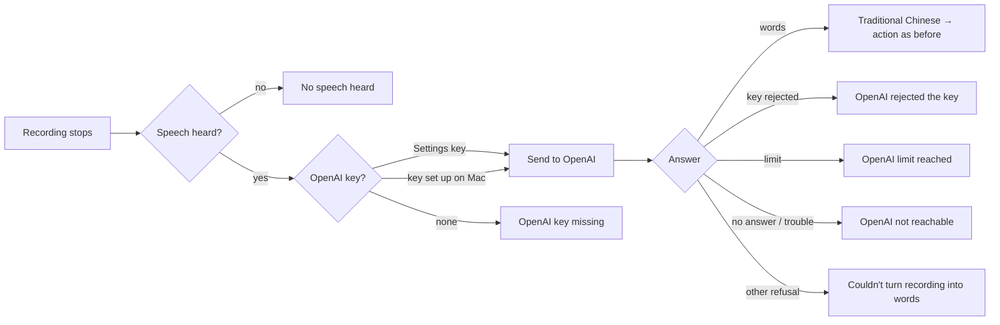

# Product Requirements Document (PRD) — OpenAI Speech Provider

**Status:** Finalized
**Version:** v1.0
**Owner:** Project owner
**Stakeholders:** Engineering, QA

---

## 1. Background & Goal (Why & Goal)

- **Problem Statement:** Speech is turned into words either by a speech model built into the app (a large download, slow on smaller Macs) or by a speech model the user must load in their local AI app next to the writing assistant model. Both cost setup effort and memory, and recognition quality is below what OpenAI's speech models give. The user wants speech recognition to run on OpenAI, and only there.
- **Expected Outcome:**
  - Settings shows one **Provider** for speech, OpenAI, selected by default; the user picks an OpenAI speech model and enters their OpenAI key once.
  - A first-time user can dictate as soon as an OpenAI key is available: no model download, no speech model in the local AI app.
  - Every failure while turning speech into words (missing key, rejected key, too many requests, no connection) ends in a clear message, never a crash.
  - Dictate, Dictate in English and Edit selection behave exactly as before once the words are heard.
- **Out of Scope:** Any change to the writing assistant, the local AI app address or the writing assistant model; other speech providers; speech recognition without internet; deleting a speech model file downloaded earlier; a "test my key" button; usage or cost display; choosing the spoken language; demo mode (keeps its simulated speech).

---

## 2. User Personas

- **Primary Role(s):** Mac knowledge worker who writes in Traditional Chinese and English, often mixing both, and has an OpenAI account.
- **Usage Context:** At their desk on a Mac with an internet connection, in any app. The local AI app still runs on the same Mac with a writing assistant model loaded.

---

## 3. User Stories & Acceptance Criteria

> Shared rules from earlier PRDs stay in force for every action unless a scenario below says otherwise: silence writes nothing ("No speech heard"), personal dictionary, Traditional Chinese, history limit of 200, clipboard restored after writing.

### US-01 — Speech is heard by OpenAI [priority: P0]
**As a** writer, **I want** what I say to be turned into words by the OpenAI speech model I chose, **so that** I get accurate words without downloading or loading a speech model myself.

```gherkin
Scenario: Dictation is heard by the default OpenAI speech model
  Given an OpenAI key is saved
  And the speech model is "gpt-4o-transcribe"
  When the user dictates "我們明天下午三點開會"
  Then the recording is turned into words by "gpt-4o-transcribe"
  And "我們明天下午三點開會。" appears at the cursor

Scenario: A newly chosen speech model is used from the next dictation
  Given the user chose "gpt-4o-mini-transcribe" and saved Settings
  When the user dictates
  Then the recording is turned into words by "gpt-4o-mini-transcribe"

Scenario: Simplified characters from OpenAI are written in Traditional
  Given OpenAI hears "我们开会"
  When Dictate finishes
  Then "我們開會。" appears at the cursor

Scenario: Dictionary words help OpenAI spell
  Given the dictionary contains "Cafler"
  When the user says "I work at Cafler"
  Then "Cafler" is given to OpenAI as a spelling hint along with the recording

Scenario: Silence is never sent to OpenAI
  Given the recording is silent
  When the user stops
  Then the status shows "No speech heard"
  And nothing is sent to OpenAI

Scenario: A full five-minute recording is heard
  Given the recording reached the 5-minute limit
  When it stops on its own
  Then the whole recording is turned into words and written at the cursor

Scenario: A speech model saved earlier stays on offer
  Given the saved speech model is "my-custom-model"
  When the user opens Settings
  Then the speech model shows "my-custom-model"
  And saving Settings keeps "my-custom-model"
```

### US-02 — OpenAI is the only speech provider [priority: P0]
**As a** writer, **I want** Settings to show OpenAI as the speech provider and nothing else, **so that** there is nothing to download or set up for speech.

```gherkin
Scenario: First launch shows OpenAI and its default speech model
  Given the app runs for the first time
  When the user opens Settings
  Then the Provider shows "OpenAI"
  And the speech model shows "gpt-4o-transcribe"

Scenario: OpenAI is the only provider on offer
  When the user opens the Provider choice
  Then "OpenAI" is the only option

Scenario: Speech model choices
  When the user opens the speech model choice
  Then it offers "gpt-4o-transcribe", "gpt-4o-mini-transcribe" and "whisper-1"

Scenario: The built-in speech model is gone
  When the user opens Settings
  Then there is no "Built-in" speech choice, no model file location and no model download

Scenario: Settings says where recordings go
  When the user opens Settings
  Then Settings states that recordings are sent to OpenAI to be turned into words

Scenario: The writing assistant still runs in the local AI app
  Given the local AI app address and writing assistant model are set
  And AI cleanup is on
  When the user dictates "嗯 我們開會"
  Then the writing assistant in the local AI app cleans it up to "我們開會。"
```

### US-03 — The OpenAI key stays secret [priority: P0]
**As a** writer, **I want** to enter my OpenAI key once and have it kept safely, **so that** it never ends up in files or logs.

```gherkin
Scenario: Saving a key keeps it in secure password storage
  Given no OpenAI key is saved
  When the user types a key and saves Settings
  Then the key is kept in the Mac's secure password storage
  And Settings shows "OpenAI key saved"
  And the app's saved settings do not contain the key

Scenario: A saved key is never shown again
  Given an OpenAI key is saved
  When the user opens Settings
  Then the key field is empty and hides what is typed
  And Settings shows "OpenAI key saved"

Scenario: A key set up on the Mac for other tools is used when none is saved
  Given no OpenAI key is saved in Settings
  And an OpenAI key is set up on the Mac for other tools
  When the user dictates
  Then that key is used
  And Settings shows "Using the OpenAI key set up on this Mac"

Scenario: The key saved in Settings wins
  Given an OpenAI key is saved in Settings
  And a different OpenAI key is set up on the Mac for other tools
  When the user dictates
  Then the key saved in Settings is used

Scenario: Removing the saved key
  Given an OpenAI key is saved
  When the user clicks "Remove key"
  Then Settings shows "No OpenAI key saved"
  And from the next dictation on, a key set up on the Mac for other tools is used if there is one

Scenario: Leaving the key field empty keeps the saved key
  Given an OpenAI key is saved
  When the user changes another setting and saves with the key field empty
  Then the saved key is unchanged

Scenario: No key anywhere
  Given no OpenAI key is saved in Settings
  And no OpenAI key is set up on the Mac
  When the user dictates
  Then nothing is written and nothing is added to History
  And the status shows "OpenAI key missing — add it in Settings › AI models"
```

### US-04 — OpenAI problems are explained [priority: P0]
**As a** writer, **I want** a clear message whenever OpenAI cannot turn my speech into words, **so that** I know what to fix and the app keeps running.

```gherkin
Scenario: Rejected key
  Given the OpenAI key is wrong or revoked
  When the user dictates
  Then nothing is written and nothing is added to History
  And the status shows "OpenAI rejected the key — check it in Settings › AI models"

Scenario: Too many requests or no credit left
  Given OpenAI says there are too many requests or the account has no credit left
  When the user dictates
  Then nothing is written and nothing is added to History
  And the status shows "OpenAI limit reached — try again later or check your OpenAI account"

Scenario: No internet
  Given the Mac has no internet connection
  When the user dictates
  Then nothing is written and nothing is added to History
  And the status shows "OpenAI not reachable — check your internet connection"

Scenario: A slow answer within one minute is accepted
  Given OpenAI answers after 59 seconds
  When the user dictates "我們開會"
  Then "我們開會。" appears at the cursor

Scenario: No answer within one minute
  Given OpenAI has not answered after one minute
  When the user dictates
  Then nothing is written and nothing is added to History
  And the status shows "OpenAI not reachable — check your internet connection"

Scenario: OpenAI is having trouble
  Given OpenAI reports it is having trouble
  When the user dictates
  Then nothing is written and nothing is added to History
  And the status shows "OpenAI not reachable — check your internet connection"

Scenario: OpenAI refuses the recording for another reason
  Given OpenAI refuses the recording, for example because the speech model is unknown
  When the user dictates
  Then nothing is written and nothing is added to History
  And the status shows "OpenAI couldn't turn the recording into words"
```

### US-05 — Earlier settings move to OpenAI [priority: P0]
**As a** writer upgrading the app, **I want** my settings to carry over, **so that** only the speech choice changes.

```gherkin
Scenario: The built-in speech choice moves to OpenAI
  Given the saved speech choice is the built-in model with a model file location
  And the saved settings have the Dictate shortcut on Fn, microphone "USB Mic", dictionary "Cafler" and writing assistant model "twil-8b"
  When the app starts
  Then the speech provider is OpenAI with "gpt-4o-transcribe"
  And the Dictate shortcut is Fn, the microphone "USB Mic", the dictionary "Cafler" and the writing assistant model "twil-8b"

Scenario: A local AI app speech model moves to OpenAI
  Given the saved speech choice is a speech model in the local AI app
  And the saved writing assistant model is "twil-8b"
  When the app starts
  Then the speech provider is OpenAI with "gpt-4o-transcribe"
  And the writing assistant model is "twil-8b"

Scenario: No speech choice saved
  Given the saved settings have no speech choice
  When the app starts
  Then the speech provider is OpenAI with "gpt-4o-transcribe"
```

---

## 4. Business Flow & Logic



- **Core Business Rules:**
  - The speech provider is always OpenAI; the speech model is the one chosen in Settings (default "gpt-4o-transcribe").
  - Key choice: the key saved in Settings; if none, a key set up on the Mac for other tools; if none, the dictation stops with "OpenAI key missing".
  - The key is looked up at each dictation, so saving or removing it takes effect from the next dictation without a restart.
  - The dictionary words are given to OpenAI as a spelling hint; no spoken language is named, so mixed Chinese and English keep working.
  - One minute is the longest OpenAI may take to answer.
  - Whenever speech cannot be turned into words, nothing is written and nothing is added to History.
- **Edge Cases:**
  - User cancels with Escape while listening: nothing is sent to OpenAI (as today).
  - The secure password storage cannot be read: treated as no saved key (falls back to the key set up on the Mac).
  - Saving the key to secure password storage fails: Settings shows the problem and the other settings are not saved either.

---

## 5. UI/UX Design & Interaction

- **Prototype Link:** N/A — follows the existing Settings window.
- **Key Interactions (Settings › AI models):**
  - Speech rows: **Provider** (choice showing "OpenAI", the only option), **Speech model** (choice of the three models, plus a saved custom model), **OpenAI key** (hidden field; next to it "OpenAI key saved" / "Using the OpenAI key set up on this Mac" / "No OpenAI key saved"; a "Remove key" button while a key is saved), and a note "Recordings are sent to OpenAI to be turned into words."
  - The local AI app address and the writing assistant model stay as they are, now described as being for the writing assistant only.
  - Gone: "Built-in" speech choice, model file location, "Download default model" and its progress.
  - Typing in the key field makes Settings count as changed, so Save becomes available.

---

## 6. Non-Functional Requirements

- **Performance:** Stopping to text appearing stays under 4 seconds for a 15-second recording on a normal connection (OpenAI plus writing assistant).
- **Security:** The OpenAI key is kept only in the Mac's secure password storage; never in saved settings, History, logs or messages. Recordings travel to OpenAI over an encrypted connection.
- **Privacy:** Recordings now leave the Mac; Settings and the project description say so. Selected text and cleanup still stay on the Mac.
- **Compatibility:** macOS 13+.
- **Analytics / Tracking:** N/A.

---

## 7. Dependencies & Risks

- **External Dependencies:** OpenAI speech service and the user's OpenAI account; the Mac's secure password storage.
- **Known Risks:**
  - Ad-hoc signed rebuilds may make macOS ask again before the app can read its saved key.
  - OpenAI may rename or retire speech models; a saved custom model stays selectable and a refusal shows a clear message.
  - Cost: every dictation is billed to the user's OpenAI account.

---

## 8. Appendix

- Requirements brief: `BRIEF.md` in this folder.
- Earlier features: `.sdd/2026-11-22-voice-dictation/`, `.sdd/2026-11-22-three-dictation-modes/`.
